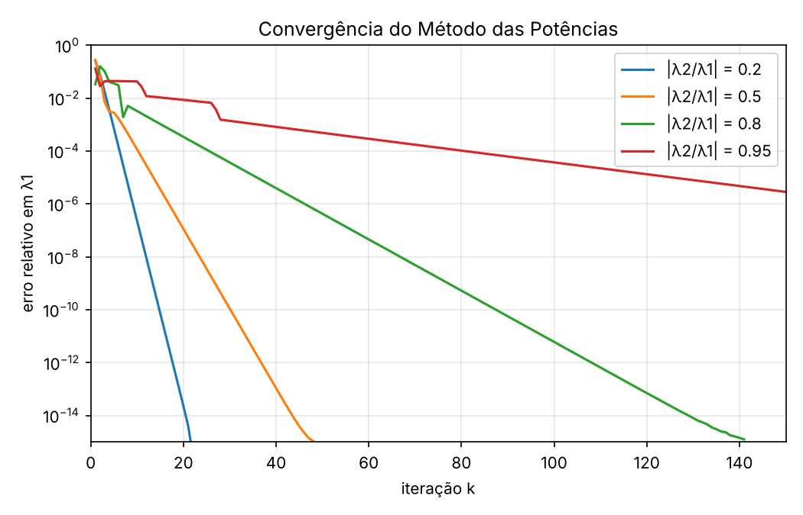
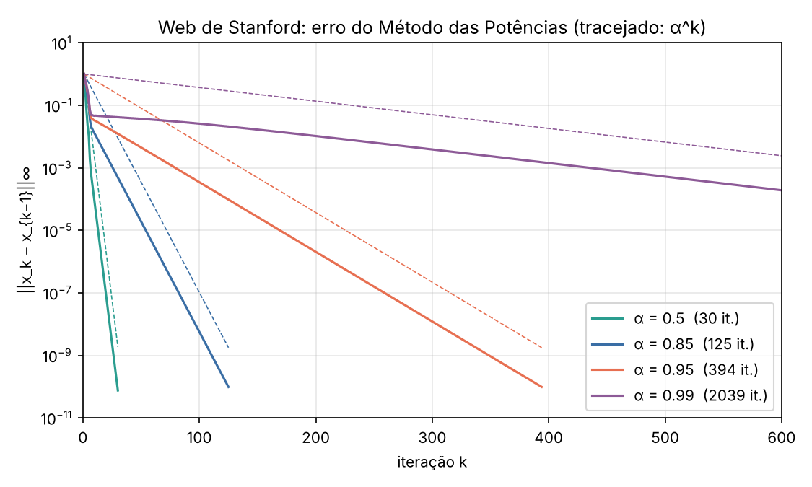
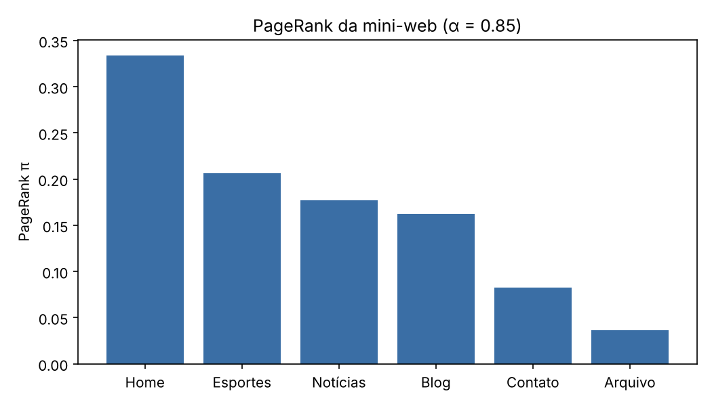

# Método das Potências — autovalores/autovetores e aplicação no PageRank

## Arquivos

| Arquivo | Conteúdo |
|---|---|
| `metodo_potencias.py` | Implementação do método: `metodo_potencias` (autovalor dominante) e `metodo_potencias_inversa` (menor autovalor ou o mais próximo de σ). |
| `exemplos_validacao.py` | Matriz 3×3 comparada com `numpy.linalg.eig`, efeito de \|λ2/λ1\| na convergência e o método inverso. |
| `pagerank.py` | Problema real: PageRank numa mini-web de 6 páginas, comparação de custo com `eig` e PageRank da web real de Stanford (281.903 páginas, 2,3 milhões de links). |
| `dados/web-Stanford.txt.gz` | Grafo real da web de Stanford (SNAP, 2002). Se faltar, o script baixa sozinho. |

## Como rodar

```bash
pip install -r requirements.txt
python exemplos_validacao.py
python pagerank.py          # ~30 s
```

## Resultados principais

**Validação (matriz 3×3):** λ1 = 6,895106515929 em 38 iterações. O valor bate com o do `numpy` até a 11ª casa decimal, e o resíduo ‖Av − λv‖ fica em 3·10⁻¹².

**Convergência:** o erro cai como |λ2/λ1|^k. As iterações sobem de 22 para 581 quando a razão vai de 0,2 para 0,95.



**PageRank:** o vetor de importância é o autovetor dominante da matriz de Google G = αS + (1−α)/n·11ᵀ, e o autovalor dominante é λ1 = 1. Como |λ2| ≤ α, o erro cai como α^k.

| | Resultado |
|---|---|
| Mini-web (6 páginas) | O resultado é idêntico ao do `eig`: a diferença é de 3·10⁻¹⁴. |
| Custo com n = 2000 | O Método das Potências leva 0,002 s e o `eig` denso leva 4,9 s. |
| Web de Stanford | Para α = 0,85 foram 125 iterações em cerca de 1 s. A matriz densa ocuparia 636 GB, e a esparsa ocupa 29 MB. |
| α = 0,5 / 0,85 / 0,95 / 0,99 | São necessárias 30 / 125 / 394 / 2039 iterações. O gráfico abaixo confirma a taxa α^k. |
| Ranking | A 4ª página no PageRank é só a 96ª em número de links recebidos: importa quem aponta para ela, não só quantos. |





## Pontos para a apresentação

1. **Por que funciona:** em A^k x0 = c1λ1^k [v1 + Σ (ci/c1)(λi/λ1)^k vi], todos os termos com i ≥ 2 vão a zero.
2. **Limitações:**
    - O método precisa de |λ1| > |λ2|.
    - x0 precisa ter componente na direção de v1.
    - A convergência é lenta quando |λ2/λ1| ≈ 1.
    - Ele só encontra um autovalor por vez. Para os outros, usa-se o método inverso ou a deflação.
3. **Por que é usado no Google:** cada iteração custa apenas um produto matriz-vetor esparso, O(nº de links), e a matriz nunca é montada. Além disso, α controla a velocidade de convergência, independentemente do tamanho da web.

**Observação sobre o critério de parada:** o código para quando a variação de λ e a variação do vetor x ficam, ambas, abaixo da tolerância. Olhar só para λ pode parar cedo demais. Isso aconteceu num teste do método inverso com σ = 3: duas estimativas seguidas coincidiram por acaso, e o resultado saiu 3,4 em vez de 3,3973.

## Dados

J. Leskovec, K. Lang, A. Dasgupta, M. Mahoney. *Community Structure in Large Networks*. Internet Mathematics 6(1), 2009. Disponível em [SNAP](https://snap.stanford.edu/data/web-Stanford.html).
